# sbar

Keep CPU, RAM, GPU, disk, and network stats visible while you work in your shell. A persistent terminal status bar for macOS and Linux, written in Rust.



*Illustrative model-training demo with example metrics and output. [View the still image](assets/social-preview.png).*

Try the stable release on macOS or Linux:

```bash
brew install funkydude755/tap/sbar
sbar
```

Type `exit` or Ctrl+D to return to your normal shell. [Installation details](#install) · [How it works](#how-it-works) · [Report a bug](https://github.com/funkydude755/sbar/issues/new)

**v0.2.3 beta:** the disk-selection and mixed-GPU fixes are available in the [source release](#from-source-v023-beta). Homebrew currently installs stable v0.2.2 with prebuilt bottles.

Updates every second. Bars scale to fill your terminal width. Per-core CPU grid, multi-GPU utilization and VRAM, network download/upload throughput.

The disk meter in v0.2.3 shows the root filesystem (`DISK /`). On macOS it prefers the writable `/System/Volumes/Data` volume (`DISK Data`), with `/` as a fallback. If neither system volume is reported, the disk meter is omitted. Mixed GPUs show their individual models and memory capacities when space allows. Network rates sum all reported interfaces, including loopback and virtual interfaces.

Narrow terminals use a compact layout. Short terminals show fewer metrics to leave room for the shell. Metrics run in a background worker; GPU probes time out after 750 ms so a slow driver cannot block typing.

## Install

### Homebrew (macOS and Linux)

The [public tap](https://github.com/funkydude755/homebrew-tap) provides prebuilt bottles for Apple Silicon and Intel Macs on macOS 15 or newer, and for Linux on x86-64 and ARM64. Normal bottle installs do not need Rust or LLVM. No GitHub account or organization access is required.

Without a compatible bottle, or with `--build-from-source`, Homebrew builds the tagged release and installs Rust and its build dependencies. Older Linux distributions may need Homebrew's runtime libraries.

If `sbar` is already installed from another tap, run `brew uninstall sbar` before installing it from this tap.

### From source (v0.2.3 beta)

Build from source with current stable Rust and Cargo, Git, Make, and a C toolchain/linker. On macOS, install the Xcode Command Line Tools; on Linux, install your distribution's C build tools. Python 3 is needed only for the regression tests.

```bash
git clone https://github.com/funkydude755/sbar.git
cd sbar
git checkout v0.2.3
make install PREFIX="$HOME/.local"
"$HOME/.local/bin/sbar" --version
```

Add `$HOME/.local/bin` to your shell's `PATH` to run `sbar` by name. To use a different installation directory, set `PREFIX`; the default is `/usr/local`, which must be writable by your user:

```bash
make install PREFIX=/path/to/prefix
```

The executable is installed in `PREFIX/bin` and license notices in `PREFIX/share/licenses/sbar`. Run `make uninstall` with the same `PREFIX` to remove them.

See [CHANGELOG.md](CHANGELOG.md) for release changes.

## Usage

```bash
sbar
```

This launches your shell inside a PTY with the status bar pinned to the bottom. Type `exit` or Ctrl+D to return to your normal shell.

## Commands

| Command | Description |
|---------|-------------|
| `sbar` | Launch shell with status bar |
| `sbar --once` | Print metrics once and exit |
| `sbar --version` | Print version |
| `sbar --help` | Show help |

## How it works

1. `sbar` allocates a PTY pair, forks your `$SHELL` into the slave side, and puts the real terminal in raw mode
2. A poll loop forwards I/O between your terminal and the PTY; a background worker collects CPU/RAM/GPU/Disk/Network metrics every second
3. The status bar is painted below the shell's scroll region
4. Terminal resizes (SIGWINCH) dynamically adjust the PTY, scroll region, and bar layout
5. On shell exit, SIGTERM, or SIGHUP, the terminal settings are restored and the child shell is cleaned up

## Terminal compatibility

Use an interactive terminal with ANSI cursor controls and scroll-region support. When a program enters the alternate screen using modes 47, 1047, or 1049, `sbar` pauses the bar and gives the program the full terminal dimensions. The bar resumes when the program leaves the alternate screen. Painting is deferred while an escape sequence or UTF-8 character is incomplete.

`sbar` forwards shell output; it is not a complete terminal emulator. An ordinary clear-screen command can erase the bar until the next metrics refresh. Programs that manage custom scroll regions or use unusual terminal modes can still disrupt the display; run them outside `sbar` if needed. `sbar --once` prints a snapshot without wrapping a shell.

## Why Rust?

The bar runs continuously. CPU, memory, disk, and network metrics use native system APIs. GPU monitoring uses `ioreg` on Apple Silicon or `nvidia-smi` on Linux when available.

## Development

With Rust and Python 3 installed, run `make test` for unit tests and isolated PTY regression tests against the debug binary. Run the full local validation commands in [CONTRIBUTING.md](CONTRIBUTING.md) before submitting changes or preparing a release. This repository does not run GitHub CI.

See [CONTRIBUTING.md](CONTRIBUTING.md) for bug reports and pull requests, [SECURITY.md](SECURITY.md) for private vulnerability reports, and [RELEASING.md](RELEASING.md) for the release checklist.

## Supported platforms

- **macOS** — Apple Silicon, Intel
- **Linux** — GPU metrics are optional and use `nvidia-smi` for NVIDIA GPUs

## License

[MIT](LICENSE). Notices for the locked macOS and Linux dependencies are in [THIRD_PARTY_LICENSES.md](THIRD_PARTY_LICENSES.md).
